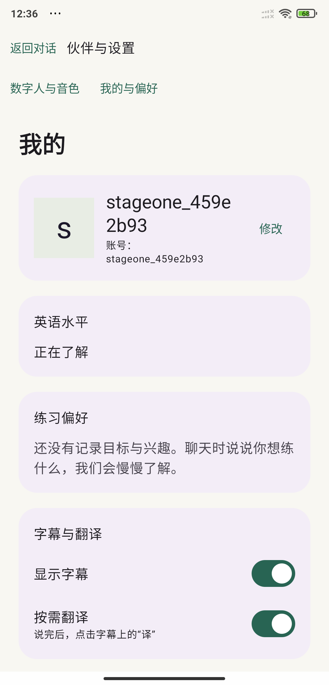

# 数字人主界面与静默待机：第 1 步交付记录

日期：2026-10-14。范围仅为计划第 1 步；第 2～5 步等待用户确认后实施。

## 可体验行为

- 首次注册或保存选择失效时，先确认数字人与音色。候选在 Android `UiState.selection` 中，已确认选择在后端 `home.selection` 中；默认候选不写入服务端，按“确认伙伴”或“应用”后才保存。旧账号已有有效保存选择时直接进入主界面。
- 数字人对话页始终是主界面。进入时创建业务会话、订阅 SSE、预连接接收音视频，保持静默。“开始”独立触发开场，不申请录音权限。
- 连接未就绪时点击开始会保存意图，等实际 `CONNECTED` 后才提交 `/opening`；重复点击不创建第二条连接或重复提交开场。失败后可以再次点击开始准备。
- 未点击开始的待机在取得会话编号后最多保留 60 秒，自动关闭媒体及业务会话，页面保留开始入口。重复网络失败通知不延长已存在的待机计时。
- 左上角进入“伙伴与设置”，复用现有数字人/音色及个人资料页面。浏览、返回保持媒体连接；“应用”保存候选，配置变化时结束旧会话并重新静默准备。
- 后台、退出登录、离开 Activity 时停止监听并关闭连接；返回前台重新准备，开场仍需主动点击。未开始状态没有语音输入控件。

## 实际改动与职责

Android 项目位于 `D:\develop\code\project\jugao\android`，沿用现有三个层次：app 负责账户与入口、feature-talk 负责对话交互状态、core-rtc 负责媒体协议。

| 文件 | 本步改动 |
| --- | --- |
| `app/.../MainActivity.kt` | 登录后的主界面路由、设置覆盖层、前后台释放与恢复、只在语音操作时请求权限 |
| `app/.../AccountViewModel.kt` | 已确认选择与候选分离，确认/应用后保存 |
| `app/.../AccountScreens.kt` | 复用选择页，区分确认与应用按钮 |
| `feature-talk/.../TalkViewModel.kt` | 待机/开始意图/开场状态、60 秒释放、网络重试、代次隔离、迟到会话认领与清理、延迟语音协商 |
| `feature-talk/.../TalkScreen.kt` | 始终可见的主界面、待机开始按钮、左上设置、模式和用户可读状态 |
| `core-rtc/.../SpokenRtcClient.kt` | 初次只接收音视频；首次语音沿原音频 transceiver 协商双向，不关闭 PeerConnection；采集源显式释放，旧连接回调按代次过滤 |
| `core-net/.../AccountStore.kt`、`LoginExpiry.kt` | 兼容实际后端的数字到期时间与历史 ISO 日期字符串 |
| `core-net/src/test/.../LoginExpiryTest.kt` | 到期协议、纳秒精度、过期边界及非法值的 6 项回归检查 |

本步没有修改 Java 业务代码、Agent 装配链路或数据库迁移。七个 Maven 模块和既有 DDD 边界继续沿用；教材、课程工具与可信工具上下文留在后续步骤。工作前已有的账户接入、AEC 和网络改动均保留，没有重置工作区。

## 媒体与取消处理

预连接不能用“创建麦克风轨道后禁用”代替不采集。新链路初次只创建 `RECV_ONLY` 音频 transceiver，不创建 `AudioSource` 或本地音轨。用户取得录音权限并主动使用语音后，才创建上行轨道、通过原 sender 挂载，并在同一个 PeerConnection 上重新交换 offer/answer。

首次语音保留原 AEC3、降噪及 APM 采集后处理设置。按住手势在申请权限时已经结束，授权回调只提示重新按住，不能恢复那次已经松手的录音；首次协商期间松手同样取消后续的手动采集。

业务会话、媒体准备、开场和麦克风分别持有任务；关闭会话递增操作代次并取消旧任务。建会话请求在有界的不可取消认领区接收响应，取得编号后关闭退出期间迟到的会话。网络失联导致无法取得创建结果时仍依赖服务端既有会话回收机制，客户端不能保证未知编号已被立即释放。

## 发现并修复的入口问题

开发后端登录响应的 `expiresAt` 实际为 Unix 秒小数，例如 `1794544452.390...`；Android 原先调用 `Instant.parse`，只能解析 ISO 字符串，导致重新启动后加密令牌无法恢复。

`LoginExpiry` 在协议边界兼容这两种格式，使用 `BigDecimal` 保留纳秒精度，拒绝非法值及错误单位，不改变后端全局日期序列化。实测原先已保存的测试账号在修复后恢复成功，并直接进入已选伙伴的待机主界面。

## 验证结果

环境：MI 8，Android 10，USB 调试；手机 `8080 → 电脑 8091` 保留原开发映射。仅使用独立测试账号。测试临时改变的录音授权和 USB 亮屏设置在结束时恢复。

| 检查 | 结果与证据 |
| --- | --- |
| Android 构建 | `:app:assembleDebug` 成功，APK 已安装到测试手机 |
| 网络模块测试 | 原有 `AccountNetworkTest` 5 项 + 新增 `LoginExpiryTest` 6 项，共 11 项通过 |
| 首次确认 | 注册后先显示伙伴页；确认后进入数字人主界面，无自动开麦 |
| 再次进入 | 修复到期解析后，保存账号与伙伴直接恢复，无需重新选择 |
| 静默待机 | 收到 576×576 画面，界面保持“待机/开始”；日志没有开场提交；AudioFlinger 显示没有活动录音客户端 |
| 无录音权限 | 临时撤销录音权限后，画面连接与开场正常；首次按住说话才出现录音授权对话框 |
| 授权后的手势 | 授权后没有补启动录音；需重新按住，或主动开启实时语音 |
| 首次语音协商 | 同一 PeerConnection 完成第二次协商，没有第二次媒体 `start`；画面继续显示，AEC 采集回调正常 |
| 后台释放 | 实时监听停止，上行关闭；WebRTC 48 kHz 与断句器 16 kHz 采集轨道移除，音频系统无活动录音客户端 |
| 设置浏览 | 左上设置可打开伙伴及英语水平/偏好页面；返回待机无第二次媒体 `start` |
| 应用新音色 | 测试账号由 Cherry 改为 Serena；点击应用后返回主界面，重新收到画面并保持待机，没有自动开场 |
| 60 秒释放 | 12:35:46 准备，12:36:46 自动释放；主界面仍保留开始按钮，未自动再建会话 |
| 释放后开始 | 连续点击开始只接受一次意图；重新准备后只提交一次开场 |

实测耗时（单机、开发网络样本，不代表服务承诺）：

- 预连接到首批视频帧约 **6.0～6.8 秒**，主要耗时在首次 offer 交换约 5.1 秒。
- 已连接时点击开始到服务端 `tts.start` 媒体开始事件约 **1.51～1.60 秒**；手机实际听到声音还包含播放缓冲，未单独测声学延迟。
- 首次语音二次协商约 **159～262 毫秒**，原有录音源探测仍额外需要约 3 秒。
- AEC 采集钩子为 **48 kHz、单声道**，连续回调可用。本步没有完成外放条件下的声学消回声量化及多机型对话测试，这一项仍需体验验收，不能把回调正常当作消回声质量已证明。

详细日志、界面 XML、截图与构建日志保存在后端 `spoken-server-app/target/stage-one`，该目录为本机验证产物，未作为源码提交。保留展示截图见下方。

最终 APK：`D:\develop\code\project\jugao\android\app\build\outputs\apk\debug\app-debug.apk`，SHA-256：`9A96F179BE12B5FE3831CED27D10A3A86C9A9E0C2D7843F7E9EAFFDEA938D421`。最终构建记录为 `android-build-release.log`，无源码 Git 提交；本步改动保留在工作区供审阅。

| 静默待机 | 点击开始后的对话 | 左上进入设置 |
| --- | --- | --- |
|  |  |  |

## 体验顺序与下一步

1. 手机打开“口语训练”；当前为独立测试账号，可从设置退出并登录自己的账号。
2. 已保存有效伙伴时直接看到数字人待机；点击开始听开场。
3. 先体验按住说话和实时语音，关注外放回声、首次启用等待与后台停止。
4. 点击左上设置，浏览后返回；也可等待 60 秒释放，再点击开始。

本步等待用户确认后再进行第 2 步伙伴与设置整理。教材目录、练习选择面板、最近课程与 Agent 工具尚未引入。
