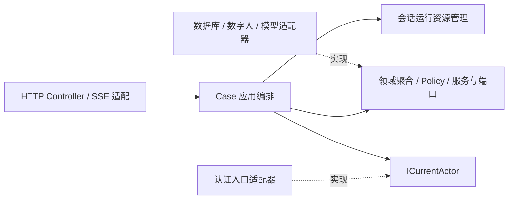

# Case 层六边形架构调整

本次调整将 HTTP 协议转换、应用编排、领域规则和运行资源生命周期分开，保留现有外部请求与响应结构。

## 依赖方向

- Case 的 Maven 依赖不再包含 API 模块；接口使用应用命令、结果以及领域值对象。
- HTTP DTO、发音结果转换、SSE 事件名称和心跳留在 trigger。
- `ICurrentActor` 为应用输入端口，认证适配器负责读取请求上下文；持久化使用会话创建时捕获的主体。
- `SessionAccess` 统一校验会话所属账号，涵盖查询、播放、事件订阅、课程切换和跟读等入口。

## 已处理的问题

| 原问题 | 调整 |
| --- | --- |
| Conversation 与 Practice 相互调用，依赖 Lazy 装配 | 提取共享的 `ReplyCancellationCase`，消除循环依赖 |
| 回复生成、归档和资源控制集中在主用例 | 分离 `ReplyGenerationCase`、`ReplyArchiveCase`、`ConversationRuntime` |
| 完成标志先于数据库写入，失败后无法重试 | 数据事务提交后才更新运行态；回复凭据、对话文本和教学文本在同一事务中写入 |
| 流式播放与驱动事件分别处理回复完成 | 统一到完成事件处理；媒体播放结束后归档，重复通知通过凭据和运行态去重 |
| 关闭清理分散，并依赖前端 SSE 订阅 | 显式关闭、上游关闭、异常、断流和状态轮询使用统一收尾；逐项释放资源 |
| 业务规则混在应用编排中 | 学习证据校准、画像校验、课程播报语言、偏好与伙伴操作意图等移入领域 Policy |
| 可选注入掩盖生产依赖缺失 | 改为必需的构造器注入，并增加完整 case 组件装配测试 |

## 事务和生命周期约定

`ReplyArchiveCase.complete` 使用 Spring 事务，首先认领 `(session_id, reply_id)` 完成凭据，再写对话和教学文本。任一步失败时整体回滚，运行聚合保留未完成状态，允许重试。复制待更新的回合对象，避免回滚后内存对象提前呈现已完成内容。

`ConversationRuntime` 统一持有回复生成任务、媒体播放任务和上游事件连接。关闭不依赖前端订阅；清理某一步失败时仍继续释放其他资源。如果会话终态写入数据库失败，保留终态聚合以供后续关闭或轮询重试，其余运行资源照常释放。归档成功后移除活跃索引，因此后续查询已清理会话返回不存在。

数据库回复凭据保证归档去重；客户端事件仍为实时通知，没有引入持久化 outbox，不承诺断线期间的事件重放。

## 上线与验证

新增 Flyway `V19__reply_completion_receipt.sql`，部署时需要正常执行迁移。

132 项相关测试通过，覆盖 case 装配、架构依赖边界、HTTP 合约、账号隔离、课程和跟读、生命周期清理、真实 Spring/MyBatis 事务回滚与回复重试。事务测试使用 H2 MySQL 模式，尚未进行真实 MySQL 和数字人服务的端到端联调。

本机离线 Maven 验证使用缓存中的 H2 2.2.224 覆盖版本，并显式设置 Mockito javaagent；这些仅为测试命令参数，没有修改生产依赖版本。

## Conversation 是否需要另拆领域

目前 `domain.coaching.conversation` 已承担对话会话与教学状态的领域建模，无须因为 case 类较多而另建一个泛化的 conversation 限界上下文。

可以继续在同一陪练上下文中划清两组职责：会话生命周期与回复轮次负责有效轮次、打断和完成约束；教学规则负责题目、跟读目标、纠音与已播任务提交。当前 `ConversationSessionAggregate` 直接持有 `TeachingStateAggregate`，后者没有独立仓储与生命周期，实质上是会话内的教学状态对象，不应仅凭类名认定它已经是独立聚合根。

`ConversationRuntime` 的订阅、连接与取消句柄属于应用运行资源，SSE 和数字人协议属于适配器；不能为了拆领域把这些技术职责放入新领域。事务归档也仍由应用层协调仓储。

只有教学能力需要跨文本、语音等多种会话独立复用，或拥有独立持久化、一致性与团队边界时，才值得将教学提升为单独的限界上下文，并通过明确的命令和事件连接会话。现阶段先完善子模块边界和聚合内职责更合适。

代码约定：使用显式 Java 类型；接口与方法使用中文 Javadoc，关键入口补充参数和返回值约束。
