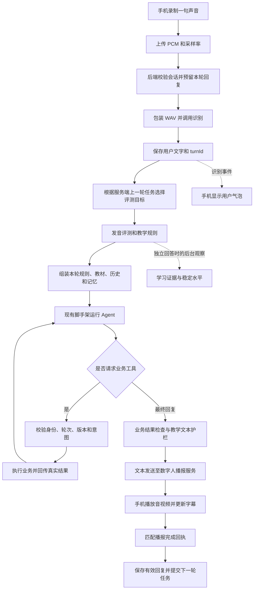

# 用户对话数据流：从说话到数字人回复

本文根据 2026-10-14 当前源码梳理，重点解释实际运行路径，而不是最初的规划。示例台词用于说明行为，不保证模型每次逐字输出相同句子。主要讲 `llm-owner=agent` 路径。

## 1. 先认识各部分

可以把手机当作话筒和播放器，把 Java 后端当作协调员，把 LLM 当作教练，把数字人服务当作语音识别和播报设备。

| 部分 | 通俗职责 | 接收和输出 |
|---|---|---|
| Android | 收音、显示对话、播放数字人、接收按钮选择 | 上传一句音频，接收文字事件和音视频 |
| Java 后端 | 确认是谁、正在练什么、上一轮要求做什么，协调全部流程 | 将声音转换为教学输入，保存真实状态，安排回复 |
| 语音识别 | 听声音并转成文字 | WAV 音频 → 用户原话 |
| 发音评测 | 在有依据时检查跟读发音 | 音频、文字、可选目标句 → 分数和可信错词 |
| 教学规则 | 确定这一轮是在跟读、求助、拒绝还是回答，以及下一步动作 | 真实任务、用户原话、评测 → 教学决策 |
| Agent / LLM | 按教学决策组织台词，并在合适时请求业务工具 | 系统要求和上下文 → 可播报回复，或工具调用 |
| 业务工具 | 查课程、切模式、保存明确偏好、换伙伴等 | 模型业务参数 + 服务器可信身份 → 真实业务结果 |
| OpenTalking 数字人服务 | 提供识别入口，并把后端生成的台词变成声音和画面 | 音频识别请求 / 已生成文本 → 识别文字 / 数字人音视频 |

LLM 在这条路径中收到的是识别后的文字及教学上下文，声音先走识别和评测。当前教练回复由 Java 侧 Agent 生成，再让数字人念出，不会把它再次交给数字人的聊天模型生成一遍。

## 2. 从进入页面到开场

1. 手机恢复登录和已保存的伙伴、音色。已有有效确认选择时直接进入数字人界面。
2. 手机创建业务会话，后端同时建立数字人供应商会话。两个编号不同，后端负责映射。
3. 后端绑定用户身份和本场稳定英语水平，初始化自由对话模式；读取最近课程作为推荐，并准备开场快照。
4. 手机连接事件通知和音视频画面，数字人静默待机。预连接不等于开启麦克风采集。
5. 用户点击“开始”，手机在媒体就绪后请求 `/opening`。该请求按固定编号去重。
6. 后端下发已准备好的开场台词。开场走直接播报，不需要 LLM 临时生成。
7. 有最近课程时，开场询问是否继续。询问真正播完后，后端激活选择任务并通知手机；手机将“继续上次课程 / 自由聊聊”放到对应回复下方。

“请求开始成功”“开场已生成”“用户听完询问”不能当成同一个时刻。继续选择必须以匹配回复的媒体完成回执为依据。

## 3. 一句话的完整旅程



### 第一步：手机收音并上传

手动录音和常开监听最终都上传一句音频。`TalkViewModel` 优先取 WebRTC 音频处理模块输出的声音，已经做过消回声；取不到时退回本地采样。

接口为 `POST /api/v1/sessions/{sessionId}/voice`。正文是 PCM 字节，`X-Sample-Rate` 表示采样率，登录信息在认证头中。采样率不是音量，也不是发音分数。

客户端还有旧注释提到“只取服务端缓冲”，但当前 Agent 路径实际上传音频正文；应以 `voicePayload` 和实际请求为准。

### 第二步：校验、识别和登记用户回合

`SessionController` 将请求交给 `ConversationCaseImpl.voice`，会话归属由现有账号/会话校验链保证。Case 预留新回复位置，取消旧模型订阅，再把 PCM 包装为 WAV。

`ConversationServiceImpl.transcribeUploadedAndRecord` 经数字人驱动调用 OpenTalking 的 `/sessions/{providerId}/transcribe`，获取文字，保存用户回合，产生 `turnId`，发送 `stt.final` 事件。

例如声音变为 `I like reading books.`，数据库得到“这是谁在哪场对话的第几轮说的话”。识别失败时不会把空文字继续交给教练。

手机有两个出口收到同轮信息：事件通知带文字与 turnId；HTTP 响应带识别结果、turnId 和可选评测。它们可能先后不同，因此手机按 turnId 合并，避免给同一句建立两个气泡或挂错评分。

### 第三步：检查上一轮任务并评测

后端读取 `session.teaching().pending()`，而不是让手机传一句目标就直接相信。

- 上一轮确实留下 READ / CORRECT 任务，且本轮文字像目标句：使用服务端目标评测。
- 用户说了别的内容：目标为空，避免把中文招呼强行和英文目标对照纠音。
- `expectedText` 只是兼容请求字段，不能改写真实任务。

评测失败可以降级为空，不能编造错词。普通发言得到的参考评分，也不能直接触发跟读纠音。

### 第四步：规则先确定输入性质和下一步动作

`TeachingPreparation.decide` 调用 `TeachingPolicy`，结合本场等级、上一轮任务、用户原话和评测生成决策。规则确定“做什么”，模型决定“怎样自然地说”。

| 状态 | 含义 | 例子 |
|---|---|---|
| `practiceInput` | 这一轮用户说的是不是练习素材 | 跟读 `How are you?` 为 true |
| `previousTask` | 用户刚刚听到的任务 | 跟读指定目标或回答指定问题 |
| `nextTask` | 这一轮回复准备给用户安排什么 | 跟读通过后准备问一个新问题 |
| `outcome` | 规则判断出的结果 | READ_PASS、READ_RETRY、HELP、RESPONDED |
| `chineseSupport` | 本轮是否需要中文支持 | L1/L2 或用户主动求助 |

特别容易误解：`nextTask=QUESTION` 不表示用户刚才在提问。跟读通过后，即使下一步改为提问，`practiceInput` 仍然为 true。

当前规则还有明确的教学选择：L1 普通轮次有 80% 跟读抽样，L2 为 50%，L3 及以上不做这种随机抽样；普通纯中文输入倾向安排英文跟读。跟读的有效总分达到 80 且没有可信错词时可通过；存在可信错词时有限次纠音，其余证据不足的情况不能编造纠错。这些是程序规则，不是 Agent 自行决定。

### 第五步：准备 LLM 每轮看到的材料

`TeachingPreparation.prompt` 与 `ReplyPromptBuilder` 组装当前输入；`ChatContextService` 添加可用历史和记忆。

系统要求包括教学等级、输入性质、唯一教学动作、语言规则和工具边界。数据材料包括：本轮用户原话、上一轮真实任务、当前模式和版本、继续选择状态，以及课程模式下的整课文本。

历史和长期记忆是参考资料，不能覆盖当前任务；预算不够时删减可选历史，保留当前原话、任务和课程。必需内容本身超预算时直接报错，不偷偷截断教材。

L1/L2 当前要求先说英语，再用“意思是：……”解释中文；可信纠音提示随后给出，最后邀请跟读。跟读目标中的问号、译意中的中文问号不应该被当成另一个聊天问题。

当前提示词还要求零评判的共建语气，普通 QUESTION 回合应有一个相关追问；READ/CORRECT 用示范和跟读邀请接续，不加第二个任务。具体可信目标词发音问题即使整句分数较高也可有限次指导，见 [准入准则](coaching-admission-principles-2026-10-14.md)。

该要求目前主要约束 Agent 生成回复。按钮切换后的固定台词与第一题走直接播报，当前实现还没有为每道原题补中文译意；不能把模型提示词约束理解为所有脚本台词也已自动翻译。

### 第六步：走现有脚手架运行 Agent

业务调用 `IChatService.handlePreparedTextStream`，仍使用原 YAML 装配的 Agent、ADK Runner 和 Spring AI 模型链路。没有新建第二套业务聊天客户端。

每轮使用短生命周期 ADK 会话，完成、异常、取消后释放。长期业务状态依靠后端重新注入，不依靠模型一直记得某个模式或账号。

`AgentReplyPreparation` 同时捕获可信调用上下文：用户主体、业务会话、turnId、模式版本、继续邀请快照和“本轮还有效吗”。`AgentToolContextRegistry` 用内部随机标识跨异步线程传递，真正调用模型前剥离标识，将上下文交给工具，模型不能填写或替换账号。

### 第七步：需要时调用工具

例如用户说“继续上次课程”，Agent 可以调用 `continueRecentLesson`。调用链为：

```text
Agent 请求工具
  → Spring AI 本地工具回调
  → SpokenPracticeTools 薄入口
  → AgentActionCase 业务编排
  → AgentActionGuard 校验
  → PracticeCase / 账号等领域能力
  → 仓储和数据库
  → 真实结构化结果回给 Agent
```

执行前校验：主体是否属于本会话、轮次是否取消、会话是否结束、模式版本是否变化、输入是否练习素材、用户原话是否允许这次操作。写操作按操作标识去重。

课程、伙伴与偏好等业务工具在跟读和角色练习回合禁用；即使供应商违规返回工具调用，本机也禁止自动执行，业务入口还有一次拒绝校验。后台能力观察、字幕翻译同样禁止执行业务工具，避免缺失 ToolContext 或误改设置。

规则兜底范围很窄：Agent 没调用工具时，明确短课程选择可以兜底；不自动猜教材，不替模型推测个人事实；已经尝试且失败的工具不盲目重试。“好”必须对应当前有效的继续邀请。

### 第八步：检查回复，然后播报

普通问答可以边生成边输出。有明确业务动作的回合先收齐模型文本，再检查实际动作结果，避免数字人声称已执行但后端没有执行。

自然兴趣/长期目标维护允许静默工具调用。它可能进入结果缓冲分支，但成功、失败或未调用不会插播“已经保存 / 还没有改设置”的回执。用户明确要求管理设置时，才需要真实操作回执。

`TeachingReplyGuard` 再检查教学文本，限制任务数量，保留 L1/L2 明确译意；它不是第二个模型，也不是完整内容纠错器。原始跟读问句不能靠护栏变成个人事实。

随后 `ConversationServiceImpl.streamReply` 将文本经 OpenTalking 文本流接口送去切句、TTS 和数字人渲染。非流式回退模式则收齐后用 `say` 原样播报。工具内部结果不直接进入 TTS。

### 第九步：手机接收与完成回执

手机接收三类东西，不能混为一个返回值：

| 通道 | 承载内容 | 手机用途 |
|---|---|---|
| HTTP `/voice` 响应 | 识别文字、turnId、评测 | 结束识别等待，关联评测 |
| SSE 事件通知 | stt.final、assistant.delta/done、practice.changed 等 | 用户气泡、教练字幕、模式和按钮 |
| WebRTC 音视频 | 数字人画面和声音 | 观看与听到实际回复 |

`text_generation.done` 仅说明文本生成结束。流式文本通道还等待 `playback_end`；媒体侧 `assistant.done` 携带匹配回复信息。后端依据有效完成回执保存实际回复，并用 `SpokenTaskResolver` 解析下一轮任务。

例如计划 READ，但实际没有播出目标和跟读邀请，就不会登记 READ；被打断的旧 replyId 不得覆盖新任务。最近课程邀请由 `PracticePlaybackCase` 激活，按钮选择播出的第一题也在媒体完成后登记成待回答问题。

## 4. 四个例子串起流程

### 例 A：普通聊天说 I like reading books.

前提：上一轮没有要求跟读这句话，本轮是自由分享。

1. 识别得到英文，保存用户回合。
2. 教学规则判断本轮不是跟读；根据等级安排下一步问答或示范。
3. 模型可以用明确原话作为兴趣依据，调用偏好工具静默维护；是否实际调用取决于模型及规则允许范围。
4. 数字人继续教学，例如问 `What books do you like?`；L1/L2 补充“意思是：你喜欢什么书？”或按本轮 READ 任务给示范。
5. 不插播“已经保存兴趣”，也不说“这次没有更改设置”。

### 例 B：跟读 How are you?

前提：数字人上一轮实际说完 `“How are you?” 意思是：你好吗？请跟读。`

1. 播报完成后，后端保存 READ 目标 `How are you?`。
2. 用户读同一句，识别文字和目标匹配，按目标评测。
3. 本轮 `practiceInput=true`。即使规则决定跟读通过、下一步提问，也不能把本轮问句当成用户询问教练近况。
4. 禁用业务工具，不保存个人兴趣，不回答 `I'm fine`。
5. 评测允许通过时可以转向新问题，例如 `What is your name? 意思是：你的名字是什么？`；需纠音时围绕原目标做有限反馈。

### 例 C：继续上次课程或点击按钮

1. 新场对话默认 FREE，只读取真实最近课程推荐。
2. 数字人询问并播完后，后端激活 pendingContinue，手机显示两项选择。
3. 语音“继续”先经历识别、教学判定、Agent 工具调用。漏调用时才允许短指令规则兜底。
4. 点击“继续上次课程”直接请求模式接口，不需要 LLM 理解，也不伪造一条用户语音记录。
5. 两条入口共用 `PracticeCase`，校验版本、去重、读取真实教材，保存最近课，发布 practice.changed。
6. 按钮切换取消旧回复并播出对应固定台词和第一题；Agent 切换保留正在执行本工具的回复，让模型根据真实结果回应。媒体画面保持连接。
7. 每轮将当前完整课重新提供给模型。继续恢复的是课，不是上次第几题。

### 例 D：今天练面试与以后重点练面试

“今天练面试”是本次意图，不能直接写成长期目标；当前教材目录没有对应课程时，不能凭空选择教材编号。

“以后重点练面试”表达长期目标，可由 Agent 请求保存；“记住，以后重点练面试”又包含明确管理命令，应根据实际结果给操作回执。两者都必须先排除引用、跟读、角色扮演及否定。

## 5. 数据究竟保存在哪里

| 数据 | 位置/形式 | 是否跨下一场保留 |
|---|---|---|
| 用户原话和普通对话回复 | conversation_turn | 是，受身份和遗忘边界约束 |
| 本轮教学决策及有效播报 | conversation_teaching_reply | 是，未完成与已完成区分 |
| 当前模式、版本、待跟读、待继续任务 | 后端运行中的业务会话/练习聚合 | 本场有效，关闭后不恢复具体任务 |
| 最近教材和课 | learner_recent_lesson | 是，用于下场推荐 |
| 教材原题、目标和辅助内容 | 应用 resources/textbooks | 本地随应用发布，运行时不访问 GitHub |
| 数字人、音色和账号明确偏好 | 账号资料与偏好存储 | 是 |
| 可召回长期记忆 | agent_long_term_memory 等现有记忆机制 | 按过期、更正和遗忘规则保留 |
| 能力回答证据与稳定水平 | learner_answer_evidence / learner_profile | 是，工具不能任意改等级 |
| ADK 本轮临时历史 | 短生命周期会话 | 本轮结束清理，不当作长期业务存储 |

能力观察是另一个后台模型请求：仅在用户独立回答上轮问题等条件成立时触发，不把跟读当成自主表达证明；观察还需经过置信度和词数校验才记录证据，不能一次跟读高分就立刻升档。

上次聊天话题与最近课程是两份数据。话题从最近实际有用户发言的会话读取已完成、非跟读记录；当前只识别安全的有限日常主题，读不出主题就用普通开场，不能编造。最近课程来自专门的最近课表。

## 6. 出问题时看哪里

| 现象 | 优先排查 |
|---|---|
| 没识别到声音、识别文字错误 | 手机音频、采样率、上传请求和 transcribe 入口 |
| 跟读问句被当成提问 | 上轮是否完成并提交 READ；本轮 practiceInput；模型收到的输入性质 |
| 普通聊天说未改设置 | AgentReplyPreparation 是否误进入明确操作回执分支 |
| 课程状态和说法不一致 | 工具执行结果、版本、practice.changed；不能只看模型台词 |
| 继续按钮出现太早 | 匹配询问的媒体结束回执、pendingContinue 和手机气泡绑定 |
| 模型没有课程内容 | TeachingPreparation.prompt 当前 COURSE 状态、教材加载和预算 |
| 模型已有文字但数字人不说 | 教学护栏后的文本、文本流连接、TTS 和媒体回执 |
| 旧回复晚到又播出 | 本轮订阅取消、replyId 与模式版本校验 |

## 7. 对应代码阅读顺序

以仓库根目录为起点，建议按这个顺序阅读：

1. trigger/http/SessionController.voice：接收请求。
2. cases/conversation/impl/ConversationCaseImpl.voice、startReply：完整一轮业务协调。
3. domain/conversation/service/impl/ConversationServiceImpl.transcribeUploadedAndRecord：识别、用户回合登记。
4. cases/conversation/impl/TeachingPreparation.decide、prompt、begin、complete：教学准备和保存时机。
5. domain/conversation/service/reply/TeachingPolicy、ReplyPromptBuilder、SpokenTaskResolver：任务与提示词规则。
6. cases/conversation/impl/AgentReplyPreparation：可信上下文、业务结果检查、有限兜底。
7. trigger/tool/SpokenPracticeTools → cases/practice/AgentActionCase、AgentActionGuard、PracticeCase：工具和按钮业务。
8. domain/conversation/service/reply/TeachingReplyGuard：可播报文本护栏。
9. ConversationServiceImpl.streamReply、applyDriverEvent → cases/practice/PracticePlaybackCase：媒体下发和完成回执。

这些类型分别位于原七个模块中，分工遵循入口 → Case 编排 → Domain 规则 → Infrastructure 适配。ADK 装配和框架实现本次未修改。
