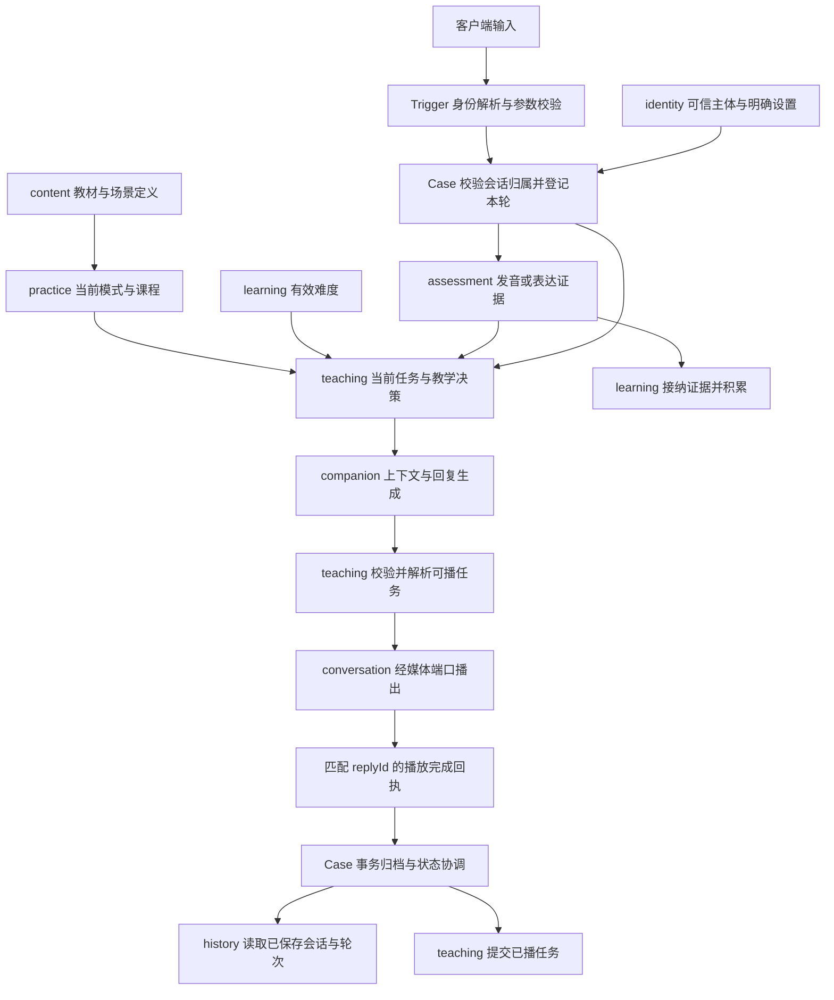

# 领域、子领域与业务归属

本文以 2026-10-16 的代码结构为依据，说明新增业务应写在哪里。属于职责划分说明，不代表拆成独立服务或独立数据库。当前仍在同一进程中，通过 Case 协调跨领域流程。

## 一、整体划分

| 领域 | 回答的业务问题 | 主要拥有的数据与规则 |
| --- | --- | --- |
| identity 身份与账号 | 是谁，明确保存了什么个人设置？ | 账号、认证、资料、设备身份规则、伙伴形象与音色选择 |
| content 学习内容 | 可以学什么，内容定义是什么？ | 教材、课文、原题、场景定义、有效编号和课程容量规则 |
| coaching 陪练 | 这一场怎么开展，这一轮教什么、练什么？ | 会话、回复有效性、教学任务、练习模式、播放确认、会话历史 |
| assessment 评测 | 这次表达表现如何，有什么可信证据？ | 发音评测、独立表达观察、证据格式与有效性 |
| learning 学习进展 | 长期表现说明什么，目前采用什么难度？ | 学习证据接纳、跨场能力等级、手动难度、能力描述和练习日统计规则 |
| companion 伙伴 | 伙伴知道哪些背景，怎样生成自然的回应？ | 对话生成入口、上下文选择、近期历史、长期记忆与遗忘规则 |

`shared` 是公共技术契约区域，目前有 `IAppConfigPort`，不算第七个业务领域。不要把无处安放的业务规则放进去。

```text
domain
├─ identity
├─ content
├─ coaching
│  ├─ conversation
│  ├─ teaching
│  ├─ practice
│  └─ history
├─ assessment
│  ├─ pronunciation
│  └─ expression
├─ learning
├─ companion
│  └─ service 下按 chat / context / memory 组织
└─ shared（技术契约）
```

`identity`、`content`、`learning` 当前没有进一步拆成独立业务子域包。`companion` 的 chat/context/memory 是服务职责分组，尚不是与 coaching 四个子域同级的独立子域结构。下文对它们按职责细分，便于定位业务，不要求为每项立即新建子域。

## 二、identity：身份与明确设置

| 职责 | 应该写的业务 | 当前落点 |
| --- | --- | --- |
| 账号认证 | 注册、登录、账号有效性、凭证校验相关规则 | `AccountService`、`IAccountRepository` |
| 资料与偏好 | 明确资料的校验与保存、修改偏好的意图判断 | `ProfilePolicy`、`PreferenceIntentPolicy`、`IProfileRepository` |
| 伙伴选择 | 选择形象和音色、验证真实目录、补全已保存选择、试听入口 | `HomeService`、`PartnerIntentPolicy` |
| 身份语义 | 账号上下文与可信设备标识规则 | `AccountContext`、`DeviceIdentityPolicy` |

例：用户说“以后叫我小明”，明确资料的保存规则属于 identity；需要从自然语言识别并执行该操作时，由 Case 协调。用户说“换成某个声音”，选择有效性属于 identity，实际重建媒体会话由 Case 和客户端协调。

不放入：自动学习等级、发音评分、当前教学目标、模型自行推断的长期记忆。HTTP 鉴权过滤器、令牌协议实现等技术细节也不直接堆进领域模型。

## 三、content：可复用的学习内容

| 职责 | 应该写的业务 | 当前落点 |
| --- | --- | --- |
| 教材与课文 | 教材列表、课名、目标、原题、课程详情、编号合法性 | `TextbookService`、`ITextbookRepository` |
| 场景定义 | 场景标识、场景说明与可用内容 | `IScenarioRepository` 及内容值对象 |
| 内容访问规则 | 轻量目录、Agent 有限候选、完整课文容量检查 | `catalog`、`agentCatalog`、`lesson` |

例：新增“餐厅点餐”课程，其内容定义放 content；用户切到这节课后的状态变化放 practice；如何围绕某一道题追问放 teaching。

不放入：某个用户现在学到哪里、是否完成本轮、当前 session 的模式、学习者等级。浏览课程不能暗中切课；查询目录不能自动替用户选择第一课。

## 四、coaching：一次陪练的活动与决策

### 4.1 conversation：会话与轮次

负责会话归属、创建时冻结的主体、会话生命周期、用户轮次、当前有效回复及完成凭据。核心对象为 `ConversationSessionAggregate`、`ConversationTurnAggregate`。

应该写：会话是否还能接收输入、哪个 replyId 有效、打断后旧回复失效、重复完成回执去重、用户回合和助手回复的归属。现有开场相遇与话题规则在 `service/opening` 下。

媒体建立、SSE、回复生成订阅和资源清理由 `cases/conversation/runtime` 编排，供应商 WebRTC、TTS、ASR 协议由基础设施适配器实现。不能因为都与“会话”有关，就把这些技术实现或所有业务策略塞进会话聚合。

不放入：纠音次数、下一轮跟读目标、选课版本、跨场能力升级。

### 4.2 teaching：当前教学决策

负责这一轮“教什么、怎么引导、下一轮让用户做什么”。核心为 `TeachingStateAggregate`、`TeachingService`、`TeachingPolicy`、`GuidedReadingPolicy`。

应该写：

- 根据用户原话、有效难度和评测证据形成教学建议。
- 区分英语学习提问、独立回答和跟读尝试。
- 选择示范、解释、追问、纠音和再次尝试等教学行为。
- 跟读开关、当前目标、目标去重、纠音次数及任务状态。
- 教学提示约束、回复守卫、从实际可播文本解析任务。
- 待播教学计划与已播任务之间的状态转换。

关键规则：生成了问题不等于用户已经听到问题。待播计划只有在匹配的媒体完成回执被确认并归档后，才能成为后续评测和教学使用的已播任务；被打断的旧回复不能提交任务。

教学领域只消费评测证据和有效档位。读取课程、账号、记忆、等级并组合本轮输入的流程在 `cases/teaching/TeachingPreparation`；跟读按钮编排在 `GuidedReadingCase`。

不放入：调用评分厂商、直接升级学习者、直接操作账号资料、实现模型 SDK 或媒体连接。

### 4.3 practice：课程练习活动

负责用户当前选择什么练习模式、哪一本哪一课，以及模式切换、版本和继续邀请等活动状态。核心为 `PracticeAggregate`、`PracticeService`、`PracticeIntentPolicy`、`PracticeSpeechPolicy`。

应该写：自由陪练与课程练习状态、课程切换规则、模式版本校验、继续邀请的接受和撤销、最近课程、练习相关开场计划。跨领域切课和首题播出确认分别由 `PracticeCase`、`PracticePlaybackCase` 协调。

例：用户切课后，旧课程的迟到播放回执不能覆盖新课程状态；是否继续练习由用户意图和当前版本决定。

不放入：教材原文定义、发音评分、整套能力等级算法。practice 管活动状态，teaching 管具体教学任务；不要为同一“当前任务”维护两套事实。

### 4.4 history：历史查询

负责已保存会话和轮次的查询、分页及历史读取规则。当前入口为 `ConversationHistoryService`、`IConversationHistoryRepository`。

应该写：查某个主体的历史会话、读取会话明细、历史记录投影。主体和会话访问校验由相应入口及 Case 共同保障。

不放入：重新推进教学状态、恢复旧媒体会话、根据查询结果修改等级。当前写入与完成归档仍由会话流程及 `ReplyArchiveCase` 负责，history 并非所有历史数据的统一写入领域。字幕翻译需要校验归属并读取已保存文本，目前在 `cases/conversation/translation`。

## 五、assessment：一次表现的证据

### 5.1 pronunciation：发音评测

负责音频相对目标文本的发音表现、评测结果与有效性。核心为 `PronunciationAssessmentAggregate`、`IPronunciationService`、`IPronunciationPort` 和评测仓储。

应该写：评测输入要求、目标文本对应关系、评分结果模型、音素或单词级结果的业务解释、评测记录。供应商调用、鉴权、协议字段转换放基础设施端口实现。

不放入：决定下一轮教什么、根据一次跟读分数升级长期英语水平。教学侧 `PronunciationEvidencePolicy` 负责判断该证据是否适用于当前任务，不替代发音评测本身。

### 5.2 expression：独立表达观察

负责根据已提出的问题和用户回答，观察是否独立回答、完成程度、候选档位和置信度。核心为 `AbilityEvidenceService`、`AbilityEvidenceVO`、`IExpressionObservationPort`。

应该写：独立表达的观察准则、结果格式校验、档位范围、置信度和独立性验证。观察失败可返回空证据，不阻塞主回复。

不放入：直接更新稳定等级、把拒绝回答判成能力低、把照读或重复示范当成独立表达。它产出观察，是否纳入长期进展交给 learning。

## 六、learning：跨场积累与难度

| 职责 | 应该写的业务 | 当前落点 |
| --- | --- | --- |
| 证据接纳 | 判断观察能否进入长期证据，排除不适用回答 | `LearningEvidencePolicy`、`LearningEvidenceVO` |
| 稳定等级 | 跨场窗口、有效证据数量、升级门槛和防重复升级 | `LearnerProgressService`、`RecentLevelPolicy` |
| 有效难度 | 手动选择优先、自动档位保留、新一轮读取有效选择 | `settings`、`select`、`forReply` |
| 进展展示 | 能力说明、近期表现和有效练习日规则 | `AbilityDescriptionPolicy`、`LearnerLevelService`、`PracticeDayPolicy` |

当前稳定等级策略要求跨场证据，在新会话开始时评估，最多提升一级；精确门槛以 `LearnerProgressService` 为准。手动选择只调整陪练难度，不改写自动能力等级或制造学习证据。

例：“把自动升级门槛从若干场调整为另一个窗口”属于 learning；“按 L2 用更短句子追问”属于 teaching。

不放入：一次音频的供应商评分、当前跟读目标、教材定义。虽然偏好由用户手动选择，但英语难度具有专门的优先级和等级语义，目前统一归 learning，而不是再存一份在 identity。

## 七、companion：生成、上下文与记忆

| 服务职责分组 | 应该写的业务 | 当前落点 |
| --- | --- | --- |
| chat 生成入口 | 接收对话命令，通过执行端口获得伙伴回复 | `CompanionChatService`、`IChatService`、`IAgentExecutionPort` |
| context 上下文 | 选择近期历史、召回记忆、组合上下文和预算裁剪 | `ChatContextService`、`HistoryProvider`、`LongTermMemoryProvider`、`HybridReducer` |
| memory 长期记忆 | 记忆召回、明确事实的确认与保存、遗忘边界 | `LongTermMemoryService`、`MemoryForgetPolicy` |

例：让伙伴记住用户明确说过的长期事实，放 memory；让下一轮只带相关历史，放 context；让这轮围绕某个英语目标追问，目标和教学约束仍由 teaching 提供。

不放入：由模型自行决定能力升级、越过 Case 执行选课或修改账号、把所有聊天原文都当成长期事实。Agent 的业务动作必须经过 `AgentActionCase` 等入口校验身份、真实意图和版本。模型 SDK、工具注册、供应商协议放基础设施。

## 八、跨领域的数据怎么流转



图中的箭头表示由 Case 传递数据的业务协作，不表示每个领域直接依赖或调用另一个领域。语音识别通过媒体/语音端口完成；不是每轮都会发起所有评测，具体取决于任务和输入。

关键标识：主体标识用于确定数据归属，业务 sessionId 关联本场各子域，turnId 关联用户轮次和证据，replyId 隔离回复及播放回执，练习版本隔离课程切换。供应商 sessionId 由适配层关联，不能替代业务主体身份。

会话和教学、练习均有运行态；教学状态关闭时释放，不依靠历史查询恢复。账号设置、内容定义、会话档案、评测记录、学习证据和长期记忆按各自存储规则持久化，不能因为共用数据库就跨领域直接改表。

当前 `ReplyArchiveCase` 用同一事务协调完成凭据、对话文本和教学文本，避免重复归档及部分成功。媒体完成后的运行态提交在会话协调中完成；不要把整个生成、网络调用和音视频播放放进数据库长事务。

## 九、业务规则与技术代码写在哪层

| 层 | 写什么 | 示例 |
| --- | --- | --- |
| API / Trigger | 请求响应契约、HTTP 路由、参数校验、协议映射 | 接收切课请求、输出字幕事件 |
| Case | 身份与会话校验、跨域取数、执行顺序、事务与状态协调 | 评测后生成教学回复，完成回执归档，切课并取消旧回复 |
| Domain | 业务状态、不变量、决策与仓储/能力端口契约 | 是否允许升级、是否可提交任务、课程版本是否有效 |
| Infrastructure | 数据库、供应商、网络、文件、模型 SDK 的具体实现 | MyBatis、OpenTalking、ASR/TTS、评测供应商、Agent 执行 |
| App | 配置和应用装配 | Bean 装配、环境配置 |

简单单领域查询可以由 Trigger 直接调用领域服务，不强制增加一层空转 Case。Domain 不依赖 Case、Trigger 或 Infrastructure；Case 通过领域端口使用外部能力。

## 十、新需求归属速查

| 新需求 | 主归属 | 需要的协作 |
| --- | --- | --- |
| 新增教材、改原题或课程目录 | content | 展示入口做 DTO 映射 |
| 切课、继续上次课程 | coaching.practice | Case 校验内容、版本并协调媒体与教学状态 |
| 改跟读流程、纠音次数或追问方式 | coaching.teaching | 消费 assessment 证据和 learning 难度 |
| 打断、关闭、重复回执处理 | coaching.conversation | Case 同步清理教学和练习运行态 |
| 增加音素评分或换评分服务 | assessment.pronunciation | 厂商接入在 infrastructure |
| 改独立表达判断标准 | assessment.expression | learning 决定是否接纳证据 |
| 自动等级、手动难度、能力说明 | learning | Case 将有效难度传给 teaching |
| 登录、改昵称、保存伙伴音色 | identity | 媒体切换另由 Case 协调 |
| 记住明确事实、撤回记忆 | companion.memory | 账号明确资料仍归 identity |
| 改历史召回和上下文预算 | companion.context | 教学规则继续由 teaching 提供 |
| 历史列表、已保存会话详情 | coaching.history | 访问校验与输出映射在入口 |
| 首页组合资料、能力和记忆摘要 | cases.overview | 分别读取 identity / learning / companion |
| WebRTC 黑屏、ICE、TTS 协议接入 | infrastructure 与 conversation runtime | 客户端媒体实现共同排查 |

## 十一、拆分依据和现阶段边界

判断归属依次看：业务问题是什么，谁拥有权威状态，规则因什么需求变化，数据保留多久，哪些变化必须一起成功。不能只按表名、接口名、页面名或某次调用使用的技术来分领域。

同样是“问题”：教材原题属于 content，当前准备教的目标属于 teaching，实际播出的文本属于会话归档，用户回答的表现属于 assessment，多场回答积累后的能力结论属于 learning。它们可以关联，不能互相替代。

以上是业务责任边界，当前实现仍有可进一步收敛的依赖：`HomeService` 复用了 conversation 的数字人目录端口；`TextbookService` 复用了 companion 的 `HybridReducer.estimate`。这不意味着形象选择归 conversation 或教材规则归 companion；后续有实际修改需求时可提取专用目录端口与容量估算契约，不在本文中另做重构。

目前不需要继续机械拆分子域。只有当一组业务具有独立术语、状态、规则和变化原因时，才考虑独立包或服务。Maven 模块、数据库和部署边界应另行按规模与一致性需求决定。

相关文档：[领域重构与迁移说明](ddd-refactoring-proposal.md)、[教学子域拆分与回执一致性](teaching-subdomain-split-2026-10-16.md)。
