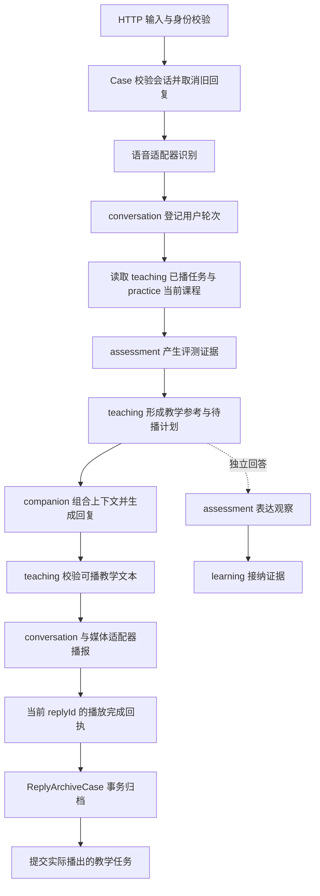

# 教学子域拆分

## 边界与依据

保留 Identity、Content、Coaching、Assessment、Learning、Companion 六个顶层业务领域。
Coaching 内分为以下子域，共用现有 Maven 模块与数据库：

| 子域 | 状态与规则 |
| --- | --- |
| conversation | 会话身份、生命周期、用户轮次、有效回复、回复完成凭据 |
| teaching | 教学档位快照、学习请求原话、待播计划、已播任务、跟读目标、目标去重和纠音次数 |
| practice | 课程模式、模式版本、继续邀请、最近课程 |
| history | 持久会话和轮次的历史查询 |

拆分依据是业务规则、变化原因和状态生命周期。教学策略调整不需要修改会话生命周期；回复取消不需要由会话聚合理解跟读细节。
当前已存在 TeachingStateAggregate、TeachingPolicy、GuidedReadingPolicy 和 SpokenTaskResolver，教学有独立的状态与规则集合。
教学任务与媒体完成仍有强一致性联系，因此通过同进程 Case 同步协调。

## 代码与数据所有权

- `domain/coaching/teaching/model`：教学状态、教学决定、任务、待播计划、跟读状态以及供教学使用的发音反馈。
- `domain/coaching/teaching/service/reply`：教学建议、跟读判断、可信发音证据筛选、提示词和实际播出任务解析。
- `domain/coaching/teaching/adapter/repository/ITeachingReplyRepository`：教学回复的持久化契约；现有基础设施实现和数据表继续使用。
- `TeachingService`：按业务 sessionId 保存本场教学聚合。所有调用由 Case 校验会话后进入；关闭会话时移除并清理待播计划。
- `cases/teaching`：TeachingPreparation 组合评测、档位、课程、上下文与记忆；GuidedReadingCase 编排跟读开关。
- `ConversationSessionAggregate`：只保存会话身份、生命周期、回复有效性、回复归属与缓冲等会话状态。`subject()` 返回创建时冻结的主体，教学不拥有账号身份。

发音评分与表达观察属于 Assessment，稳定能力证据与等级属于 Learning。教学只消费它们提供的证据和有效档位。

## 一轮数据流

TeachingPreparation.begin 只登记待播计划，不提前提交下一轮任务。
ConversationServiceImpl 在会话锁内校验 replyId，先调用 ReplyArchiveCase 完成事务，再更新会话完成标志和教学任务。
归档失败保留当前待播计划与文本缓冲，允许同一回执重试；事务同时回滚完成凭据、对话文本和教学文本。

课程按钮首题通过 PracticePlaybackCase 处理，核验当前练习版本后将实际播出的问题交给教学状态。
开场问题同样只在匹配的开场回执完成后生效。

## 打断与关闭

ReplyCancellationCase 在同一会话锁内使教学计划失效、取消生成/播放并撤销继续邀请。
ConversationServiceImpl 的回复失效协调同时更新会话回复标识与教学状态，旧 replyId 的迟到回执不能提交任务。
普通播放订阅取消也走相同的失效协调。

显式关闭、供应商关闭、状态轮询发现关闭以及错误终止均释放教学状态与媒体运行资源。
即使归档更新失败，也释放教学运行态；保留已关闭会话供归档重试，不恢复旧教学任务。
教学状态不跨会话恢复；持久教学记录、历史、最近课程及长期能力证据按各自规则保留。

## 验证

ArchitectureBoundaryTest 检查 conversation 与 teaching 的领域代码互不依赖；CaseAssemblyTest 检查应用装配不存在循环依赖。
行为回归覆盖实际播报完成后提交、旧回复隔离、重复完成去重、事务回滚重试、跟读规则、课程切换、档位热更新与各关闭路径的清理。
新增及调整代码使用显式 Java 类型，并在领域边界、事务与并发协调处添加注释。
